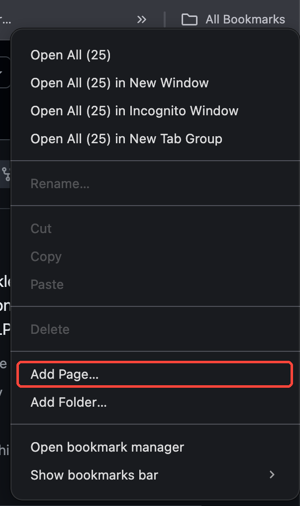
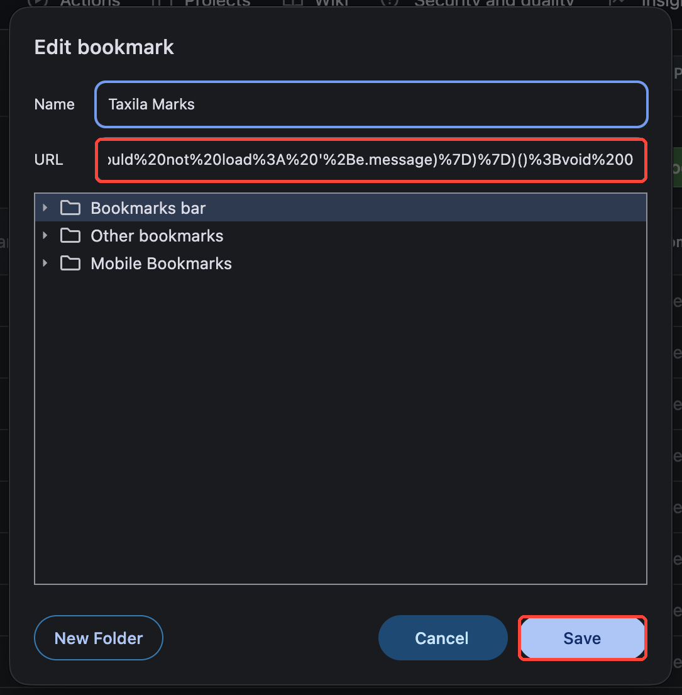
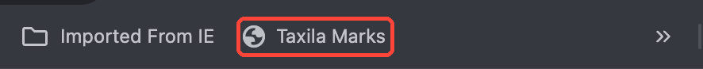

# Taxila Marks

For students in **BITS Pilani**. [Taxila](https://taxila-aws.bits-pilani.ac.in) is the BITS Pilani learning portal where courses, assignments, quizzes and grades live.

Taxila Marks is a one-click bookmark that shows your marks, upcoming deadlines and submission status for every Taxila course in one panel, instead of opening each course separately.

- **Due soon:** assignments and quizzes with a countdown (for example "in 13 h"), split into what you still need to do and what you've already submitted.
- **My marks:** every graded item in every course, coloured green, amber or red by score, with one tab per semester.

It works in desktop Chrome, Edge, Brave, Firefox and Safari while you're logged in to Taxila.

> This is an unofficial tool made by a student. It is not affiliated with, endorsed by or supported by BITS Pilani. For problems with Taxila itself, contact BITS; for problems with this tool, [open an issue](https://github.com/ashutosh486/taxila-marks/issues).

## Install

You install it once, as a bookmark. After that, updates arrive through an Update button in the panel; you never need to reinstall.

### Easiest: drag the button

1. Open the **[install page](https://ashutosh486.github.io/taxila-marks/)**.
2. Drag the green **Taxila Marks** button onto your bookmarks bar. If the bar is hidden, press `Ctrl+Shift+B` (Windows/Linux) or `Cmd+Shift+B` (Mac) first.

That's it. If dragging doesn't work in your browser, use the manual steps below.

### Manual: paste the code into a bookmark

**1. Copy the bookmark code.** Hover over the box below and click the copy icon in its top-right corner.

<!-- bookmark -->
```
javascript:(function()%7Bvar%20c%3Btry%7Bc%3DlocalStorage.getItem('tm-code')%7Dcatch(e)%7B%7D%0Afunction%20run(t)%7Btry%7B(0%2Ceval)(t)%7Dcatch(e)%7BlocalStorage.removeItem('tm-code')%3Balert('Taxila%20Marks%20failed%20to%20start%3A%20'%2Be.message%2B'%20Click%20the%20bookmark%20again.')%7D%7D%0Aif(c)return%20run(c)%3B%0Afetch('https%3A%2F%2Fraw.githubusercontent.com%2Fashutosh486%2Ftaxila-marks%2Fmain%2Ftaxila-marks.js'%2C%7Bcache%3A'no-store'%7D).then(function(r)%7Bif(!r.ok)throw%20new%20Error('HTTP%20'%2Br.status)%3Breturn%20r.text()%7D).then(function(t)%7B%0Aif(location.origin%3D%3D%3D'https%3A%2F%2Ftaxila-aws.bits-pilani.ac.in')localStorage.setItem('tm-code'%2Ct)%3Brun(t)%7D).catch(function(e)%7Balert('Taxila%20Marks%20could%20not%20load%3A%20'%2Be.message)%7D)%7D)()%3Bvoid%200
```
<!-- /bookmark -->

**2. Show your bookmarks bar** if it's hidden: press `Ctrl+Shift+B` (Windows/Linux) or `Cmd+Shift+B` (Mac). In Safari use View → Show Favorites Bar.

**3. Create the bookmark.** Name it `Taxila Marks` and paste the code as its URL (address):

| Browser | How |
|---|---|
| Chrome, Edge, Brave | Right-click the bookmarks bar → **Add Page…** (Edge: **Add favorite**). Paste the code into the **URL** field and save. |
| Firefox | Right-click the bookmarks toolbar → **Add Bookmark…**. Paste the code into the **URL** field and save. |
| Safari | Safari can't create a blank bookmark. Bookmark any page into the Favorites bar (`Cmd+D`), then right-click it → **Edit Address**, replace the address with the code, and rename it. |

#### Step by step in Chrome

**a.** Right-click an empty spot on the bookmarks bar and choose **Add Page…**



**b.** Type `Taxila Marks` as the **Name**. Delete whatever is in **URL**, paste the code, and click **Save**. Leave the folder as **Bookmarks bar**.



**c.** **Taxila Marks** now appears on your bookmarks bar. Open a Taxila page and click it.



## Use

1. Log in to Taxila and open any Taxila page.
2. Click **Taxila Marks** on your bookmarks bar. The panel opens over the page and takes a few seconds to load.
3. Close it with the **✕** in the panel's top-right corner. Links in the panel open in a new tab, so the panel stays open.

If you click the bookmark on another website, it offers to take you to Taxila. Click it again once Taxila has loaded.

## Updates

When a new version is out, a yellow bar appears at the top of the panel:

- **See what's new** opens the [changelog](CHANGELOG.md).
- **Update** installs the new version and reopens the panel. It's then saved, so later clicks open the new version straight away.

Nothing updates until you click Update.

## Privacy

- It reads your own Taxila pages, in your browser, using your existing login. It never sees your password.
- Your marks and deadlines stay in your browser. They are not sent anywhere.
- The only other site it contacts is GitHub: to download the code on first use and when you click Update, and to check whether a new version exists each time you open it.
- It only reads. It never submits, changes or deletes anything on Taxila.

The full source is [taxila-marks.js](taxila-marks.js) in this repository.

## Troubleshooting

**Nothing happens when I click the bookmark.**
Check that the bookmark's URL starts with `javascript:`. If you pasted the code into the address bar instead of a bookmark, browsers silently remove the `javascript:` part, so it has to be a bookmark.

**"Taxila Marks could not load".**
It couldn't reach GitHub on first use. Check your internet connection (some office or campus networks block GitHub) and click again.

**"Taxila Marks failed to start".**
The saved copy was damaged and has been cleared. Click the bookmark again to download a fresh one.

**"You seem to be logged out".**
Your Taxila session has expired. Log in to Taxila again and click the bookmark.

**I want a completely fresh copy.**
On a Taxila page, open the browser console (`Ctrl+Shift+J`, or `Cmd+Option+J` on a Mac), paste `localStorage.removeItem('tm-code')` and press Enter. The next click downloads the latest version.

## For maintainers

- Edit [taxila-marks.js](taxila-marks.js). Users receive it through the Update button.
- To release: bump `VERSION` in `taxila-marks.js` and the number in [version.txt](version.txt), add a `## Version N` entry to [CHANGELOG.md](CHANGELOG.md), run `node test.js`, and push to `main`. GitHub can take up to 5 minutes to serve the new files.
- The bookmark code itself lives in [build.js](build.js). Change it only if you have to, since everyone would need to reinstall. After changing it, run `node build.js`: it rebuilds the install page [index.html](index.html) (live at the GitHub Pages link above) and the code box in this README.
